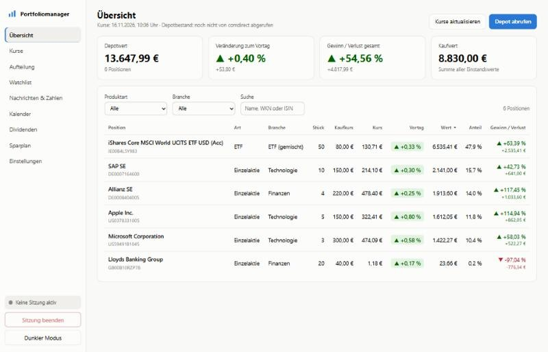
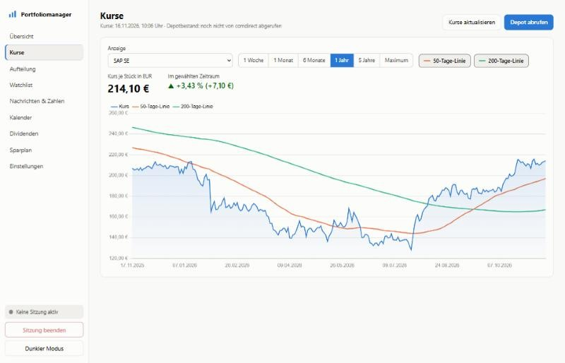

# Portfoliomanager

A local analytics tool for a personal brokerage account at comdirect (Germany). It runs entirely on your own computer, opens in the browser, and needs no paid services or API keys.



> The screenshots show a test portfolio with sample positions. The user interface is in German.

## Features

| Area | What it does |
|---|---|
| **Overview** | Portfolio value, change since the previous day, gain and loss per position, sortable table with filters by product type and sector |
| **Prices** | Price history for the whole portfolio and each position, from one week to max, with optional 50- and 200-day moving averages |
| **Allocation** | Pie charts by position, sector and product type |
| **Watchlist** | Track securities outside the portfolio, with price history, latest news and personal notes |
| **News & figures** | Headlines for each position, key metrics, revenue and earnings for recent fiscal years and quarters |
| **Calendar** | Earnings dates, ex-dividend dates, dividend payments and (estimated) annual general meetings, as month view and list |
| **Dividends** | Expected annual dividend, distribution across months, current yield and yield on cost, projection for the coming years |
| **Savings plan** | Simulation with a monthly contribution split across positions, three scenarios, optional taxes and inflation |

It also has a light and a dark mode, a start screen showing the session status, and a desktop shortcut to launch it with a double-click.

| Price chart with moving averages | Savings plan simulation |
|---|---|
|  |  |


## Data sources

- **Holdings and transactions:** the official [comdirect REST API](https://www.comdirect.de/cms/kontakt-zugaenge-api.html), read-only. Login works like online banking: access number, PIN and photoTAN approval.
- **Prices, master data, dividends, dates:** Yahoo Finance via the `yfinance` library, cached locally. Foreign currencies are converted to euros.
- **News:** Google News (German) and Yahoo Finance (English).

The tool also works without comdirect access: positions can be entered by hand or imported from a CSV file.

## Privacy and security

- The server only listens on the local machine (`127.0.0.1`) and rejects requests from other websites.
- Credentials are stored in the Windows Credential Manager, not in the project folder. Session tokens exist only in memory.
- The comdirect session ends automatically ten minutes after the last request and when the program is closed.
- The program never calls any order endpoints and cannot buy or sell anything.
- Portfolio data lives in `data/portfolio.db`. This folder is excluded from the repository via `.gitignore`.

## Installation

Requires Windows with Python 3.12 or newer.

```powershell
git clone https://github.com/089norman/portfoliomanager.git
cd portfoliomanager
python -m venv .venv
.venv\Scripts\python -m pip install -r requirements.txt
.venv\Scripts\python run.py
```

The browser then opens at `http://127.0.0.1:8765/`. To start it with a double-click, use `start-portfoliomanager.bat`.

Fetching the portfolio requires activated API access at comdirect (`client_id` and `client_secret`).

## Usage

### Starting and stopping

- **Start:** double-click the desktop shortcut or `start-portfoliomanager.bat`.
- The program keeps running in the background when the browser is closed. Another double-click only reopens the interface.
- **Stop:** Einstellungen (Settings) → „Programm beenden" (Quit program).

### Start screen and session

- The start screen shows whether a comdirect session is active and leads to the login. Clicking „Portfoliomanager" in the top left always brings you back to it.
- The session status is shown in the bottom left, with the „Sitzung beenden" (End session) button below it.
- When the session ends (manually or automatically after 10 minutes), a goodbye page appears. The program and your stored data remain available.

### Fetching the portfolio from comdirect

1. Einstellungen → „comdirect-Zugang": enter `client_id`, `client_secret` and access number and save. The PIN can be stored as well or entered on every fetch.
2. Click „Depot abrufen" (Fetch portfolio) in the top right and approve the login in the photoTAN app.
3. While the program is running, the session stays active for a while; after that, the next fetch needs a new approval.

Credentials are stored in the Windows Credential Manager (entry „Portfoliomanager-comdirect"). Only read-only portfolio endpoints are used.

Important: comdirect locks access after three wrong TAN entries or five requested but unconfirmed TAN approvals. Always complete a login you have started instead of restarting it several times in a row.

### Prices and assignments

Prices, sectors and product types come from Yahoo Finance and are cached locally. If an automatic assignment is wrong, it can be overridden under Einstellungen → „Wertpapier-Zuordnung" (Security mapping). Prices may be delayed.

### Watchlist and moving averages

- The „Watchlist" tab tracks securities that are not in the portfolio. Search by name, ISIN, WKN or ticker; German exchanges are listed first. Each entry shows price, performance, the three latest news items and your own note.
- Watchlist entries can also be selected in the „Kurse" (Prices) tab.
- In the „Kurse" tab, the 50- and 200-day lines can be switched on and off separately (average closing price of the last 50 or 200 trading days). The choice is remembered.

### News, calendar and dividends

- News, metrics and dates are cached (news 30 minutes, dates and dividends 12 hours, financials 24 hours); „Neu laden" (Reload) in each tab fetches them immediately.
- Dividends are projected from the payments of the last 12 months, gross and at the current exchange rate.
- Annual general meetings are estimated (German shares: trading day before the ex-dividend date). A meeting date entered by hand replaces the estimate for that year.

### Savings plan and dividend calculator

- Both are projections with steady growth, not forecasts.
- Scenario rates, tax and inflation are set under Einstellungen → „Annahmen für Simulationen" (Simulation assumptions).
- „Wie bisher, je Position" (Historical, per position) uses the average price growth of up to the last 10 years (limited to 0–12 % per year).

### Data and backup

- All data is stored in `data\portfolio.db`. To back it up, copy this file (quit the program first).
- `data\portfoliomanager.log` contains error messages from the last start.

## Project structure

```
app/
  main.py          Web server (FastAPI) and portfolio calculations
  comdirect.py     Login and read-only access to the comdirect REST API
  market.py        Prices, master data and watchlist via Yahoo Finance
  fundamentals.py  News, metrics, dividends, dates
  db.py            SQLite database
static/            User interface in HTML, CSS and JavaScript, no build step
run.py             Launcher
```

Built with Python, FastAPI and SQLite in the backend and Chart.js for the charts.

## Limitations

- Annual general meeting dates are estimated, as there is no reliable free source. Real dates can be entered by hand.
- Dividends, savings plan and future values are projections with steady growth, not forecasts.
- The tax calculation is an approximation of German capital gains tax (one rate, saver's allowance, optional partial exemption for funds; no advance lump sum, loss offsetting or withholding tax) and not tax advice.
- Prices from Yahoo Finance may be delayed.

## Notes

This is a private project and is not affiliated with comdirect, Commerzbank or Yahoo. It does not constitute investment advice. Use of the data sources is subject to their respective terms.

The project was developed with AI assistance using Claude Code: the requirements, domain logic and testing against a real portfolio are mine; the code was written in dialogue with the model.
