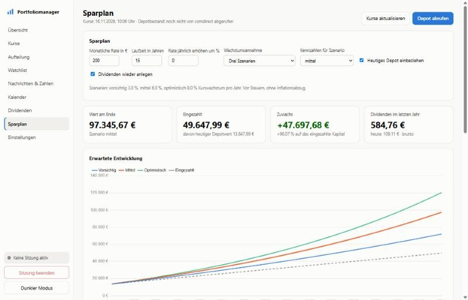
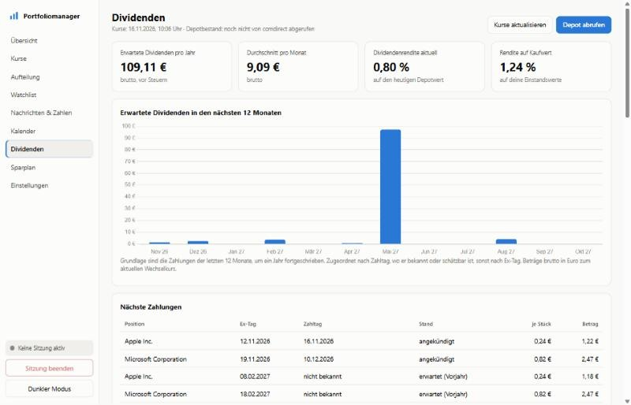

# Portfoliomanager

Ein lokales Analysewerkzeug für das eigene Wertpapierdepot bei comdirect. Das Programm läuft vollständig auf dem eigenen Rechner, öffnet sich im Browser und braucht keine kostenpflichtigen Dienste oder API-Schlüssel.


> Die Bildschirmfotos zeigen ein Testdepot mit Beispielpositionen.

## Was es kann

| Bereich | Inhalt |
|---|---|
| **Übersicht** | Depotwert, Veränderung zum Vortag, Gewinn und Verlust je Position, sortierbare Tabelle mit Filtern nach Produktart und Branche |
| **Kurse** | Kursverlauf für das ganze Depot und jede Position von einer Woche bis Maximum, zuschaltbare 50- und 200-Tage-Linie |
| **Aufteilung** | Kreisdiagramme nach Position, Branche und Produktart |
| **Watchlist** | Wertpapiere außerhalb des Depots beobachten, mit Kursentwicklung, den neuesten Nachrichten und eigenen Notizen |
| **Nachrichten & Zahlen** | Meldungen zu den Positionen, Kennzahlen sowie Umsatz und Gewinn der letzten Geschäftsjahre und Quartale |
| **Kalender** | Zahlentermine, Ex-Dividenden-Tage, Dividendenzahlungen und (geschätzte) Hauptversammlungen in Monats- und Listenansicht |
| **Dividenden** | Erwartete Jahresdividende, Verteilung auf die Monate, Rendite aktuell und auf Kaufwert, Hochrechnung für kommende Jahre |
| **Sparplan** | Simulation mit monatlicher Rate, Aufteilung auf Positionen, drei Szenarien, optional Steuern und Inflation |

Dazu kommen ein heller und ein dunkler Modus, ein Startbildschirm mit Sitzungsstatus und eine Desktop-Verknüpfung zum Starten per Doppelklick.

| Kursverlauf mit Durchschnittslinien | Sparplan-Simulation |
|---|---|
|  |  |



## Woher die Daten kommen

- **Depotbestand und Umsätze:** über das offizielle [comdirect REST API](https://www.comdirect.de/cms/kontakt-zugaenge-api.html), ausschließlich lesend. Die Anmeldung läuft wie im Onlinebanking mit Zugangsnummer, PIN und photoTAN-Freigabe.
- **Kurse, Stammdaten, Dividenden, Termine:** Yahoo Finance über die Bibliothek `yfinance`, lokal zwischengespeichert. Fremdwährungen werden in Euro umgerechnet.
- **Nachrichten:** Google News (deutsch) und Yahoo Finance (englisch).

Ohne comdirect-Zugang lässt sich das Programm ebenfalls nutzen: Positionen können von Hand angelegt oder aus einer CSV-Datei importiert werden.

## Datenschutz und Sicherheit

- Der Server ist nur vom eigenen Rechner erreichbar (`127.0.0.1`) und weist Aufrufe fremder Webseiten ab.
- Zugangsdaten liegen in der Windows-Anmeldeinformationsverwaltung, nicht im Projektordner. Sitzungstoken existieren nur im Arbeitsspeicher.
- Die comdirect-Sitzung endet automatisch zehn Minuten nach dem letzten Abruf und beim Beenden des Programms.
- Das Programm ruft keine Order-Schnittstellen auf und kann nichts kaufen oder verkaufen.
- Depotdaten liegen in `data/portfolio.db`. Dieser Ordner ist per `.gitignore` vom Repository ausgeschlossen.

## Installation

Voraussetzung ist Windows mit Python 3.12 oder neuer.

```powershell
git clone https://github.com/089norman/portfoliomanager.git
cd portfoliomanager
python -m venv .venv
.venv\Scripts\python -m pip install -r requirements.txt
.venv\Scripts\python run.py
```

Der Browser öffnet sich danach unter `http://127.0.0.1:8765/`. Für den Start per Doppelklick liegt `Portfoliomanager starten.bat` bei.

Für den Depot-Abruf wird ein freigeschalteter API-Zugang bei comdirect benötigt (`client_id` und `client_secret`). Die Bedienung im Einzelnen beschreibt [LIESMICH.md](LIESMICH.md).

## Aufbau

```
app/
  main.py          Webserver (FastAPI) und Depot-Berechnungen
  comdirect.py     Anmeldung und lesender Abruf beim comdirect REST API
  market.py        Kurse, Stammdaten und Watchlist über Yahoo Finance
  fundamentals.py  Nachrichten, Kennzahlen, Dividenden, Termine
  db.py            SQLite-Datenbank
static/            Oberfläche in HTML, CSS und JavaScript ohne Build-Schritt
run.py             Startprogramm
```

Verwendet werden Python mit FastAPI und SQLite im Hintergrund sowie Chart.js für die Diagramme.

## Grenzen

- Hauptversammlungstermine sind geschätzt: Für sie gibt es keine verlässliche kostenlose Quelle. Bei deutschen Aktien wird der Handelstag vor dem Ex-Dividenden-Tag angenommen; echte Termine lassen sich von Hand eintragen.
- Dividenden, Sparplan und Zukunftswerte sind Hochrechnungen mit gleichmäßigem Wachstum, keine Prognosen.
- Die Steuerberechnung ist eine Näherung (ein Steuersatz, Sparerpauschbetrag, optional Teilfreistellung) und keine Steuerberatung.
- Kurse von Yahoo Finance können zeitverzögert sein.

## Hinweise

Dies ist ein privates Projekt und steht in keiner Verbindung zu comdirect, der Commerzbank oder Yahoo. Es stellt keine Anlageberatung dar. Die Nutzung der Datenquellen unterliegt deren jeweiligen Bedingungen.

Entwickelt wurde das Projekt KI-gestützt mit Claude Code: Anforderungen, Fachlogik und Tests am echten Depot stammen von mir, die Umsetzung in Code entstand im Dialog mit dem Modell.
